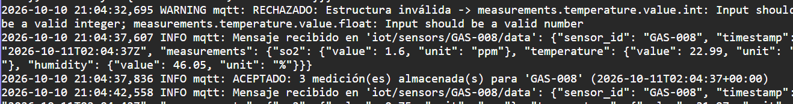
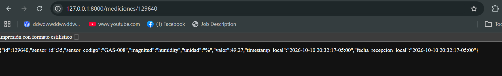
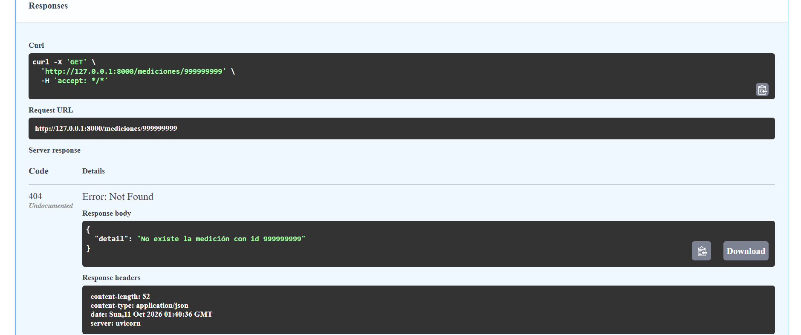
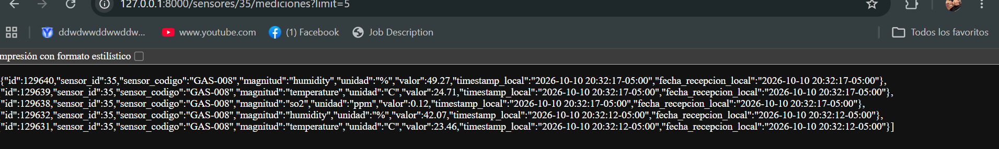
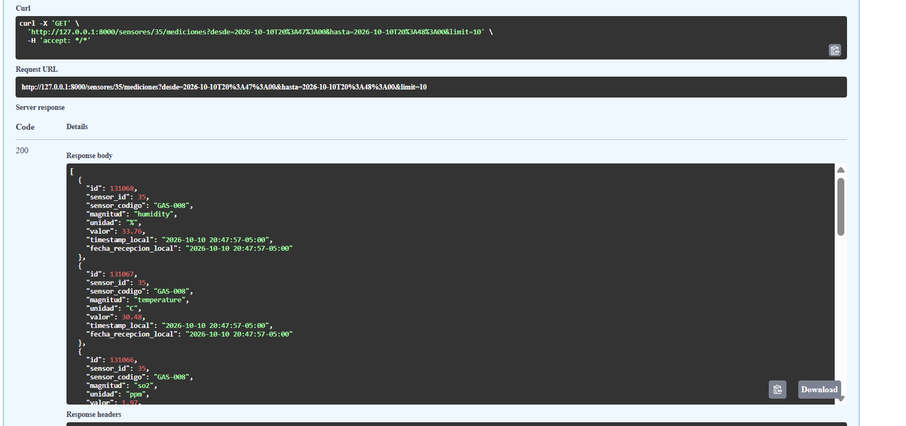
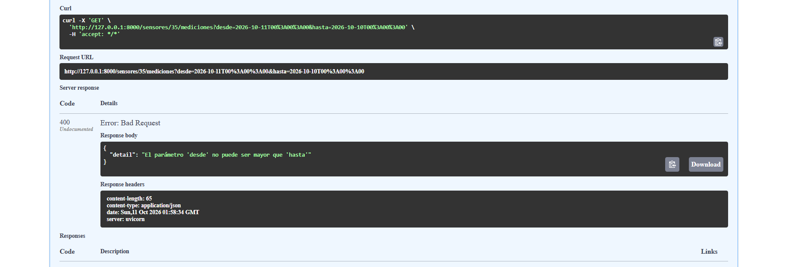
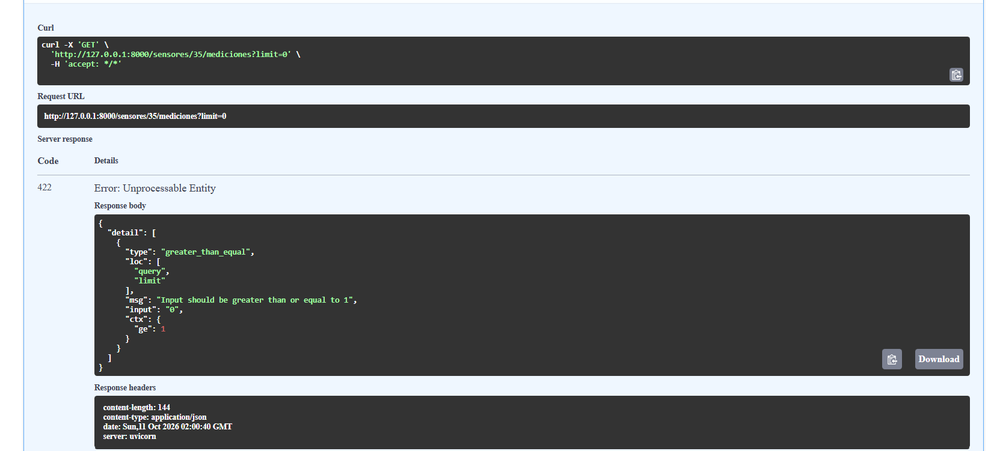
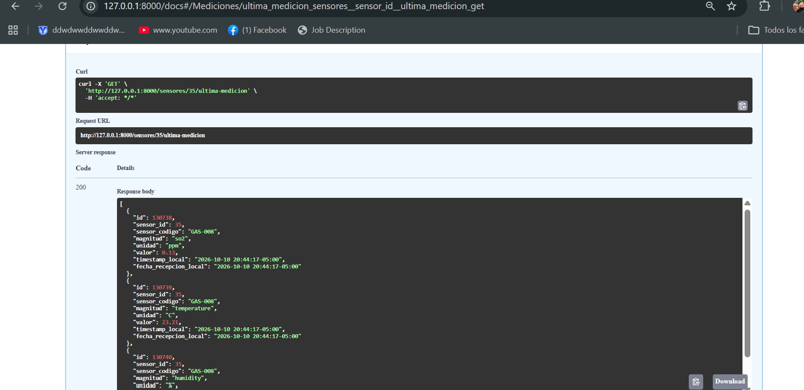
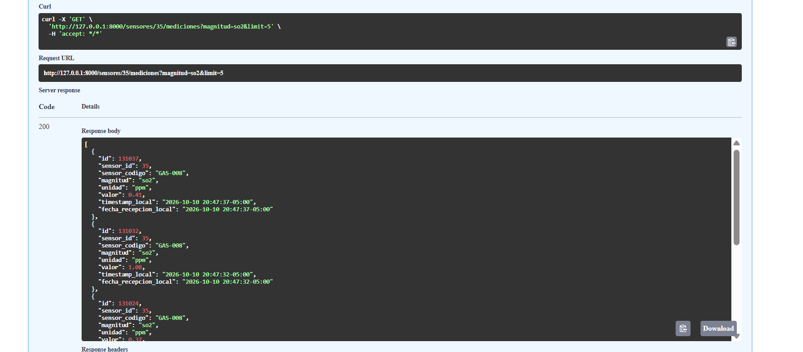
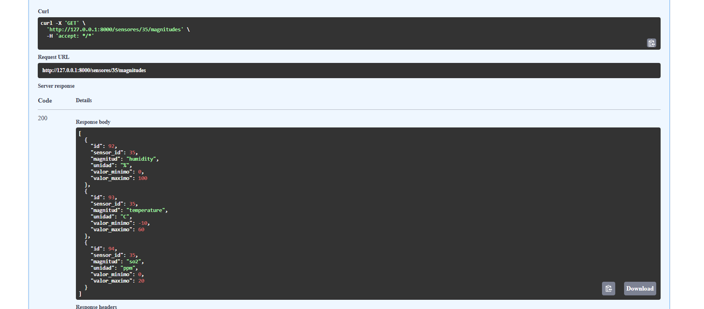

# Taller 2 — API IoT (FastAPI + MQTT + PostgreSQL)

## 1. Información general
- **Proyecto:** API para adquisición, validación y consulta de datos IoT
- **Integrantes:** SARA YULIETH QUIMBAYO OSORIO (sarao755)
- **Asignatura:** Aplicaciones y Servicios Web
- **Fecha:** 10 de octubre de 2026
- **Sensor asignado (codigo):** `GAS-008` (id 35, "Dióxido de azufre")
- **Tópico MQTT utilizado:** `iot/sensors/GAS-008/data` (broker `emqx.coriotlab.co`)

## 2. Descripción del sistema
**Problema resuelto:** un sensor de dióxido de azufre publica mediciones por MQTT. La aplicación se suscribe a su tópico, valida cada mensaje, guarda en PostgreSQL únicamente los válidos y permite consultarlos mediante una API REST.

**Arquitectura:**
```
Sensor → Broker MQTT → mqtt/client.py (Pydantic + ORM) → PostgreSQL ← crud/ ← api/ (FastAPI)
```

**Magnitudes y unidades del sensor GAS-008** (según el catálogo en PostgreSQL):

| Magnitud | Unidad | Valor mínimo | Valor máximo |
|---|---|---|---|
| `humidity` | `%` | 0 | 100 |
| `temperature` | `C` | -10 | 60 |
| `so2` | `ppm` | 0 | 20 |

**Payload real recibido del sensor:**
```json
{
  "sensor_id": "GAS-008",
  "timestamp": "2026-10-11T02:04:37Z",
  "measurements": {
    "so2": {"value": 1.6, "unit": "ppm"},
    "temperature": {"value": 22.99, "unit": "C"},
    "humidity": {"value": 46.05, "unit": "%"}
  }
}
```
- `sensor_id` corresponde al campo `codigo` de la tabla `sensores` (no al `id` numérico).
- `timestamp` llega en UTC (formato ISO 8601 con `Z`); `value` es numérico y `unit` es texto.

**Reglas de procesamiento:**
1. El mensaje debe ser JSON válido y cumplir la estructura (Pydantic).
2. El sensor debe existir y estar activo.
3. Cada magnitud debe pertenecer al sensor, con la unidad correcta y un valor dentro del rango.
4. Si **todas** las magnitudes son válidas, se guarda una fila por magnitud en `mediciones`, con el mismo `timestamp_utc`. Si alguna falla, no se guarda nada.
5. En las respuestas GET la hora se convierte de UTC a hora de Colombia (`America/Bogota`).

## 3. Configuración del entorno
```bash
python -m venv venv
venv\Scripts\Activate.ps1          # Windows (Linux/Mac: source venv/bin/activate)
pip install -r requirements.txt
copy .env.example .env             # y completar con los datos del docente
uvicorn app.main:app
```
Variables de entorno requeridas (sin valores sensibles): `MQTT_BROKER`, `MQTT_PORT`, `MQTT_TOPIC`, `MQTT_USERNAME`, `MQTT_PASSWORD`, `MQTT_KEEPALIVE`, `DB_HOST`, `DB_PORT`, `DB_NAME`, `DB_USER`, `DB_PASSWORD`.
El archivo `.env` no se sube al repositorio (está en `.gitignore`).
Documentación interactiva: `http://127.0.0.1:8000/docs`

## 4. Base de datos
- Conexión por variables de entorno en `app/database/connection.py` (PostgreSQL, base `appdb`).
- Tablas utilizadas (según `data-model.md`): `sensores` (1:N) `sensor_magnitudes` (1:N) `mediciones`.
- Claves foráneas: `sensor_magnitudes.sensor_id → sensores.id` y `mediciones.sensor_magnitud_id → sensor_magnitudes.id`, ambas con `ON DELETE RESTRICT`.
- La aplicación **solo lee** `sensores` y `sensor_magnitudes` y **solo inserta** en `mediciones`.

## 5. Organización del código
| Carpeta | Función |
|---|---|
| `app/schemas/` | Modelos Pydantic: validación del payload MQTT y formato de las respuestas |
| `app/models/` | Modelos SQLAlchemy ORM (tablas y claves foráneas) |
| `app/crud/` | Acceso a datos (consultas; el único insert es en `mediciones`) |
| `app/api/` | Endpoints FastAPI y códigos HTTP |
| `app/mqtt/` | Cliente suscriptor y proceso de validación y almacenamiento |
| `app/database/` | Engine, sesión y dependencia `get_db` |
| `app/utils/` | Conversión de UTC a hora de Colombia |
| `scripts/` | Script que reproduce las pruebas de mensajes inválidos |

## 6. Endpoints implementados
| Método | Ruta | Descripción |
|---|---|---|
| GET | `/sensores` | Lista de sensores |
| GET | `/sensores/{id}` | Sensor por id (404 si no existe) |
| GET | `/sensores/por-codigo/{codigo}` | Sensor por código |
| GET | `/sensores/{id}/magnitudes` | Magnitudes de un sensor |
| GET | `/sensor-magnitudes/{id}` | Sensor-magnitud por id |
| GET | `/mediciones/{id}` | Medición por id |
| GET | `/sensores/{id}/mediciones` | Histórico. Filtros combinables: `magnitud`, `desde`, `hasta`, `limit` |
| GET | `/sensores/{id}/ultima-medicion` | Medición más reciente (una por magnitud). Filtro opcional `magnitud` |

Fechas: se almacenan en UTC y las respuestas GET se muestran en hora de Colombia. Los parámetros `desde` y `hasta` sin zona horaria se interpretan como hora de Colombia.

## 7. Evidencias de funcionamiento
Las evidencias están en la carpeta [`evidencias/`](evidencias/).

| # | Prueba | Datos de entrada | Resultado obtenido | Archivo y función | Evidencia |
|---|---|---|---|---|---|
| 1 | Recepción MQTT | Tópico `iot/sensors/GAS-008/data` | Mensaje recibido y mostrado en el log | `app/mqtt/client.py` → `_on_message` |  |
| 2 | Medición válida almacenada | Payload con `so2`, `temperature` y `humidity` válidos | `ACEPTADO: 3 medición(es) almacenada(s)`; 3 filas con el mismo timestamp | `app/mqtt/client.py` → `procesar_payload`; `app/crud/medicion.py` → `create_mediciones` |  |
| 3 | Sensor inexistente | `sensor_id: "NO-EXISTE-999"` | RECHAZADO, no se guarda | `app/mqtt/client.py` → `procesar_payload` | [03-07-rechazos.txt](evidencias/03-07-rechazos.txt) |
| 4 | Unidad incorrecta | `unit: "UNIDAD_MALA"` | RECHAZADO, no se guarda | `app/mqtt/client.py` → `procesar_payload` | [03-07-rechazos.txt](evidencias/03-07-rechazos.txt) |
| 5 | Tipo de dato incorrecto | `value: "abc"` | RECHAZADO (estructura inválida). También ocurrió en un mensaje real del servicio | `app/schemas/medicion.py` → `MedidaMQTT` | [03-07-rechazos.txt](evidencias/03-07-rechazos.txt) y captura de la evidencia 1 |
| 6 | Magnitud incorrecta | `magnitud_falsa` | RECHAZADO, no se guarda | `app/mqtt/client.py` → `procesar_payload` | [03-07-rechazos.txt](evidencias/03-07-rechazos.txt) |
| 7 | Timestamp inválido | `"ayer por la tarde"` | RECHAZADO, no se guarda | `app/schemas/medicion.py` → `PayloadMQTT._parse_timestamp` | [03-07-rechazos.txt](evidencias/03-07-rechazos.txt) |
| 8 | Consulta por ID existente | `GET /mediciones/129640` | 200, registro de `humidity` | `app/api/medicion.py` → `obtener_medicion` |  |
| 9 | Consulta por ID inexistente | `GET /mediciones/999999999` | 404 | `app/api/medicion.py` → `obtener_medicion` |  |
| 10 | Consulta histórica | `GET /sensores/35/mediciones?limit=5` | 200, datos históricos en hora de Colombia | `app/api/medicion.py` → `historico` |  |
| 11 | Consulta por rango de fechas | `desde=2026-10-10T20:47:00&hasta=2026-10-10T20:48:00` | 200, solo registros de ese minuto | `app/crud/medicion.py` → `list_mediciones` |  |
| 12 | `desde` mayor que `hasta` | `desde=2026-10-11...&hasta=2026-10-10...` | 400 | `app/api/medicion.py` → `historico` |  |
| 13 | Validación HTTP incorrecta | `?limit=0` | 422 (`greater_than_equal`) | FastAPI: `Query(ge=1)` en `app/api/medicion.py` → `historico` |  |
| 14 | Última medición | `GET /sensores/35/ultima-medicion` | 200, las 3 magnitudes del mensaje más reciente | `app/crud/medicion.py` → `get_ultima_medicion` |  |
| 15 | Últimas N mediciones | `?limit=5` | 200, solo 5 registros, los más recientes primero | `app/crud/medicion.py` → `list_mediciones` |  |
| 16 | Filtro por magnitud | `?magnitud=so2&limit=5` | 200, solo registros de `so2` | `app/crud/medicion.py` → `_query_sensor` |  |
| 17 | Claves foráneas | `GET /sensores/35/magnitudes` | 200, 3 magnitudes con `sensor_id: 35` | `app/models/sensor_magnitud.py` y `app/models/medicion.py` (`ForeignKey`) |  |
| 18 | Separación de responsabilidades | — | Código organizado en capas | Estructura de `app/` (sección 5) | — |

Las pruebas 3 a 7 se pueden reproducir con: `python -m scripts.probar_validaciones GAS-008`

Nota: la aplicación se dejó recibiendo datos más de 20 minutos, y se almacenaron las mediciones válidas del sensor GAS-008.

## 8. Control de versiones
- **Repositorio:** https://github.com/Sarao755/apps_services_2 (rama `taller-2`)
- **Evidencia de commits:** historial de la rama `taller-2` en GitHub
- **Aporte de cada integrante: SARA YULIETH QUIMBAYO OSORIO:trabajo individual,configuracion del entorno, integracion con MQTT,validaciones con pydantic y ORM, endpoints con FastAPI, pruebas y evidencias 

## 9. Conclusiones
- **Aprendizajes:** se integró un suscriptor MQTT con una API FastAPI, validando en dos capas (estructura con Pydantic y reglas de negocio con el ORM) y guardando solo las mediciones válidas, de forma atómica por mensaje.
- **Dificultades:** configurar el entorno en Windows (política de ejecución de PowerShell), evitar subir archivos internos de Visual Studio (`.vs/`) a Git y manejar la conversión entre UTC y hora de Colombia.
- **Soluciones aplicadas:** se habilitó la ejecución de scripts solo para la sesión, se agregó `.vs/` al `.gitignore`, se usaron tipos estrictos en Pydantic y `zoneinfo` para las conversiones de zona horaria.
